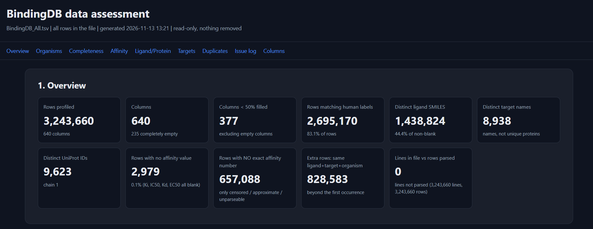

# BindingDB report generator

Turn a huge BindingDB TSV file (millions of rows, 640 columns) into **one self-contained HTML report** that you can open in any browser, with no Python knowledge needed to read it.



**Live example:** https://turfstack.github.io/bindingdb-report/example_report/bindingdb_report.html
*(works once GitHub Pages is switched on for this repo)*

## What it does

- Reads a BindingDB TSV file **read-only**. Nothing is cleaned, dropped or changed.
- Writes one HTML file with nine sections: Overview, Organisms, Completeness, Affinity, Ligand/Protein, Targets, Duplicates, Issue log, Columns.
- The report contains **aggregate statistics only** (counts, histograms, top-N names and IDs). No data rows are copied into it.
- Streams the file in chunks, so it fits on a normal laptop (developed on Windows with 16 GB RAM).

## Disclosure: AI-generated code

Most of this code was generated with the help of a large language model (Claude, by Anthropic), then run and checked by the author. It may contain mistakes. Please verify any number that matters to your work (see "Checking the numbers" below).

## Requirements

- Python 3.9 or newer
- `pandas` 1.3 or newer and `numpy` (listed in `requirements.txt`)
- A BindingDB TSV file, downloaded from the BindingDB download page: https://www.bindingdb.org/rwd/bind/chemsearch/marvin/Download.jsp

## Quick start

**1. Get the code and install the packages**

```bash
git clone https://github.com/turfstack/bindingdb-report.git
cd bindingdb-report
python -m venv .venv
```

Activate the environment:

```bash
source .venv/bin/activate          # Linux / macOS / WSL
.venv\Scripts\Activate.ps1         # Windows PowerShell
```

```bash
pip install -r requirements.txt
```

**2. Try it on a small slice first (about a minute)**

```bash
python bindingdb_report.py "path/to/BindingDB_All.tsv" --max-rows 100000 --out trial.html
```

**3. Run it on the whole file**

```bash
python bindingdb_report.py "path/to/BindingDB_All.tsv" --out bindingdb_report.html
```

Then open `bindingdb_report.html` in your browser.

## Options

| Option | Default | Meaning |
|---|---|---|
| `tsv` (required) | | Path to the BindingDB TSV file |
| `--out` | `bindingdb_report.html` | Output HTML file |
| `--chunk` | `50000` | Rows read at a time. Lower it (for example `25000`) if you run out of memory |
| `--max-rows` | all rows | Only profile the first N rows (trial run) |
| `--title` | `BindingDB data assessment` | Report title |
| `--human-labels` | `Homo sapiens`, `Human`, `Homo sapiens (Human)` | Organism spellings counted as human |

## How to read the report

- **Overview**: size of the file and headline counts. The "lines in file vs rows parsed" card shows whether any lines were skipped.
- **Organisms**: which organism labels exist, and which spellings are counted as human.
- **Completeness**: how full the key columns are, and how many of the 640 columns are empty or sparse.
- **Affinity**: how many values are exact numbers, censored (`>` or `<`), or text; pKd / pKi / pIC50 histograms.
- **Ligand/Protein**: distinct SMILES, InChI Keys and sequences, and length distributions.
- **Targets**: UniProt IDs, target names, and IDs with more than one sequence or name.
- **Duplicates**: three definitions from loose to strict (same ligand + target + organism; plus identical affinity values; plus identical source).
- **Issue log**: observations with counts and shares. These are simple proportions, not severity ratings.
- **Columns**: fill rate of every column that has data.

## Limitations

- Built for the standard BindingDB TSV column layout. If a required column is missing, the script stops and lists what it could not find. Other BindingDB TSV downloads with the same columns should work, but they have not been tested.
- Targets are keyed by the UniProt ID of **chain 1** only.
- A cell counts as "filled" if it is not an empty string, so whitespace-only cells count as filled in the column statistics.
- Duplicate counts are heuristics, and assay conditions are not compared.
- "Distinct" counts use 64-bit hashes of the text. A collision is possible in theory but extremely unlikely at this size.

## Checking the numbers

Two independent checks you can run yourself (Linux, macOS or WSL):

```bash
wc -l BindingDB_All.tsv
```

This counts lines. Subtract 1 for the header and compare with the row count in the report.

```bash
awk -F'\t' 'NR==1{for(i=1;i<=NF;i++) if($i=="Target Source Organism According to Curator or DataSource") c=i; next} $c=="Homo sapiens"||$c=="Human"||$c=="Homo sapiens (Human)"{n++} END{print n}' BindingDB_All.tsv
```

This counts rows with one of the three human labels. It should match the "Rows matching human labels" card, give or take a few rows where whitespace was trimmed.

Validation done so far:
- Compared against an independent pandas computation on a synthetic 640-column test file.
- - Full run on `BindingDB_All.tsv` (release 202610, 3,243,660 rows): the `awk` count of human-labelled rows was 2,695,170, matching the report, and the line count matched the rows parsed (nothing skipped). Run time: about 3 minutes on a Windows laptop with 16 GB RAM (observed, not formally timed).

## Data, license and citation

This repository contains **code and an example report only**, not BindingDB data.

- BindingDB: https://www.bindingdb.org
- Data curated by BindingDB is shared under a Creative Commons Attribution license; data imported from ChEMBL is CC BY-SA 3.0. See https://www.bindingdb.org/rwd/bind/info.jsp for the current terms.
- Please cite BindingDB:

> Liu T, Hwang L, Burley SK, Nitsche CI, Southan C, Walters WP, Gilson MK. BindingDB in 2024: a FAIR knowledgebase of protein-small molecule binding data. *Nucleic Acids Research* 53(D1):D1633-D1644 (2025). https://doi.org/10.1093/nar/gkae1075

- The example report was generated from BindingDB release `202610` (`BindingDB_All.tsv`).
- The code in this repository is released under the MIT License (see `LICENSE`). The license covers the code only, not BindingDB's data.
